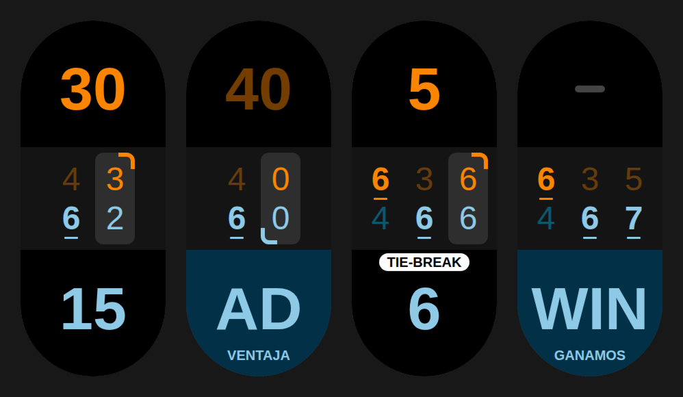
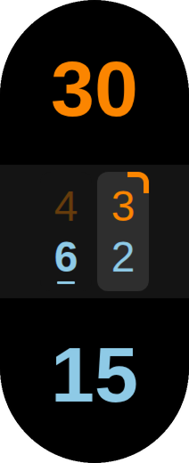
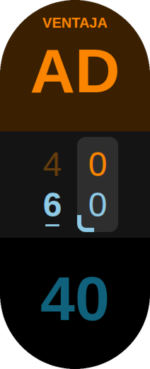
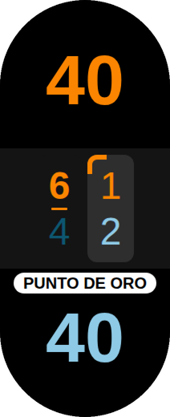
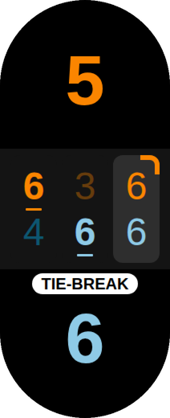
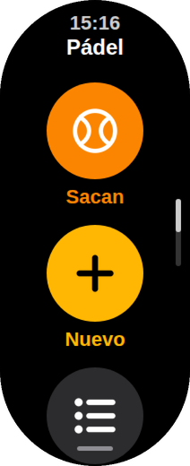
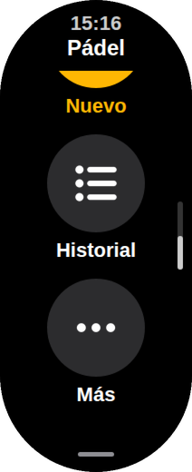
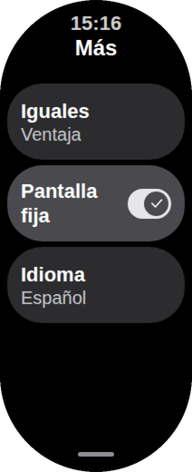
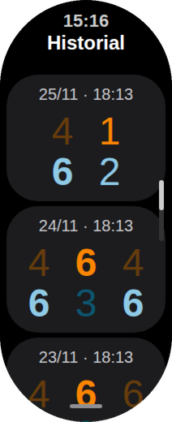
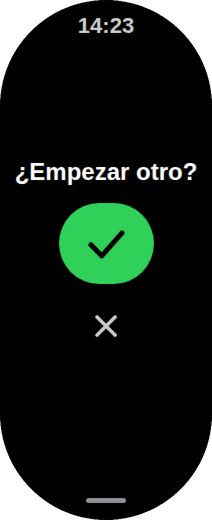

# Pádel — padel score counter for Xiaomi Smart Band 10

A padel scoreboard that runs on the **Xiaomi Smart Band 10**, built as a Xiaomi
Vela JS quick app (`.rpk`). Tap to score, swipe left to fix mistakes, and see
every set at a glance without leaving the court.



<sub>Rendered from the compiled app in the test harness (212 × 520 px capsule
screen). The app speaks Spanish (the default), English, French, German
and Italian.</sub>

> **Unofficial.** Xiaomi has no public way to install third-party apps, so
> Pádel is installed by sideloading (see [Install](#install-with-miband-hack)).
> This project isn't affiliated with Xiaomi.

## Features

- **Split screen.** The top half (orange) is the opponents and the bottom half
  (blue) is your team, on a black panel. Orange/blue stays distinguishable
  with red-green color blindness, and black keeps the AMOLED panel cheap on
  battery.
- **Scoreboard in the middle.** It has one column per set, with the opponents'
  games on top and yours below. The set in play sits on a grey tile. In a
  finished set, the winner's number is bold and underlined and the loser's is
  dimmed.
- **Clear status cues.**
  - *Advantage:* the leading half lights up and shows a bold **AD** with
    *VENTAJA*, while the rival's 40 dims.
  - *Tiebreak / deciding point:* a white pill (`TIE-BREAK`, `PUNTO DE ORO`,
    `STAR POINT`) appears just below the scoreboard without moving anything
    else.
  - *Match over:* the winner's half lights up with **WIN** in its color and *GANAMOS*
    or *GANAN*, and the other half shows a dimmed bar.
- **Serve indicator.** A bracket in the serving team's color on one corner of the current-set tile
  shows who serves and from which side. The tile's corners are the court
  seen from your side: top corners are the opponents, bottom corners are
  your team. So the marked corner is where the server stands, and you can
  point at it: "you serve from there now". Their right is the screen's
  left, because they face you.
- **Who serves first.** Each new match asks *¿Quién saca?*: tap the team
  that serves first. Everything else follows from the rules: teams
  alternate games (across sets too), each game starts from the right, and
  the side switches every point. In a tiebreak the team whose turn it is
  serves one point, then two each.
- **Full padel rules.** Points go 0 / 15 / 30 / 40. At deuce (*iguales*),
  pick one of three rules: **advantage**, **golden point** (*punto de oro*:
  the next point wins) or **Star Point** (FIP, 2026: advantage at the first
  two deuces, and the third is decided by one point). Sets go to 6, won by
  2, with a **tiebreak** to 7 (won by 2) at 6-6. Matches are best of 3.
- **Haptics.** You get a short buzz for each point and a long buzz when a point
  wins a game, so you can feel the score without looking.
- **Keep screen on.** This is optional. The setting is released when you leave
  the app.
- **Nothing is lost.** The match is saved after every point, so it survives if
  the band closes the app.
- **Match history.** The last 10 matches are kept, the one in play included,
  with the date and the games of each set.
- **Five languages.** Spanish (the default), English, French, German and
  Italian, chosen in *Más*.

## How to use it

| Gesture | On the top half (them) | On the bottom half (us) |
| --- | --- | --- |
| **Tap** | +1 point to them | +1 point to us |
| **Swipe left** | −1 point to them | −1 point to us |
| **Swipe down** (or long-press) | Opens the panel | Opens the panel |
| **Swipe right** | Exits the app | Exits the app |

**Swipe left** removes that side's most recent point. If that point was the
last one played, it's fully undone, even if it closed a game, a set or the
match. If that side has no point to remove in the current game (right after
a game or set closes, or once the match is won), it undoes the last point
played instead, whoever won it. So swiping on either half keeps rewinding,
all the way back to 0-0.

**Panel** (swipe down to open it). It slides down over the score and back
up when it closes. It follows Wear OS's Material 3 design (sizes, spacing,
toggles, dialogs), scaled to the band. On top, a header with the time and
the view's title. Below, round buttons in one column that scroll freely;
the next one peeks at the bottom edge. Swipe up from the handle at the
bottom edge, or right, closes it. It opens from the who-serves screen too.

- *Sacamos* / *Sacan*: who serves now, in the team's colour. Tap
  it to switch; the serve indicator updates for the whole match.
- *Nuevo*: start a new match. It asks *¿Empezar otro?* (cancel or confirm),
  then who serves. The current match stays in the history.
- *Historial*: the last 10 matches, newest first, each a small copy of the
  scoreboard with its date; the set in play sits on a grey tile, as on the
  scoreboard. Scrolls like the panel.
- *Más*: the settings that outlive a match. *Iguales* shows the deuce rule
  and a tap moves to the next one (*Ventaja*, *Punto de oro*, *Star
  Point*). *Pantalla fija* keeps the screen on while the app is open
  (released when you leave it). *Idioma* picks the language: Español,
  English, Français, Deutsch or Italiano; a tap moves to the next one.

A right swipe in *Más*, *Historial* or the new-match question goes back to
the panel; a swipe up from the handle closes them.

## Screens

| Who serves? | Mid-match | Our advantage |
| :---: | :---: | :---: |
|  |  |  |
| **Their advantage** | **Golden point** | **Tiebreak** |
|  |  |  |
| **We won** | **They won** | **Panel** (swipe down) |
|  |  |  |
| **Panel, scrolled** | **Más** | **Historial** |
|  |  |  |
| **New match?** | | |
|  | | |

How to read the scoreboard in the middle: each column is a set, with their
games (orange) on top and ours (blue) below. In *Mid-match*, we won the first
set 6-4 (bold and underlined) and trail 2-3 in the second (grey tile). The
orange bracket on the tile's top-right corner says they serve next, from
their left.

## Download

Get the latest `.rpk` from
[Releases](https://github.com/IlanVivanco/padel-band/releases). See the
[changelog](CHANGELOG.md) for what changed in each version. Release builds
are debug-signed and compiled to JSC bytecode, which is what the band needs to
sideload them.

Releases are published automatically: when a merge to `main` carries a
`versionName` (in `src/manifest.json`) that has no release yet, the
[Release workflow](.github/workflows/release.yml) builds the `.rpk` and
publishes it, with that version's section of the changelog as the notes.

## Install with MiBand Hack

[MiBand Hack](https://miband.trinh.uk)
([source](https://github.com/ptrinh/miband-hack)) is a web app that installs
`.rpk` apps on Mi Band 8 / 9 / 10 straight from the browser over Bluetooth.
You don't need to install anything.

### What you need

- **Chrome or Edge.** Safari and Firefox don't support Web Serial or Web
  Bluetooth. It has been tested from Chrome on Android. On Windows and Linux,
  desktop Chrome or Edge works too. On Linux you may need to turn on
  `chrome://flags/#enable-experimental-web-platform-features`. For macOS, see
  [Troubleshooting](#troubleshooting).
- **The band already paired with Mi Fitness.** That pairing is what produces
  the auth key.
- **The `.rpk`** from [Releases](https://github.com/IlanVivanco/padel-band/releases).

### 1. Get the auth key

Open [miband.trinh.uk](https://miband.trinh.uk). In **step 1**, sign in with
your Xiaomi account to fetch your band's auth key. The site uses the login once
and doesn't store it. The site lists other ways to get the key under *Other
ways to get the auth key*.

> The key changes if you **unpair the band in Mi Fitness or reset it**. If
> that happens, fetch it again.

### 2. Free the band

The band talks to only one device at a time.

- **Force-stop Mi Fitness**: Settings → Apps → Mi Fitness → Force stop. If you
  skip this, Mi Fitness reconnects and takes the connection.
- If you're installing from a **computer**, also turn off Bluetooth on your
  phone in its Settings, not just in quick settings.

### 3. Pair the band with this device (first time only)

1. If the band is already listed in this device's Bluetooth settings, remove
   it.
2. On the band, open **Settings → System → Connect to new phone** and keep
   that screen open.
3. Pair the band from this device's Bluetooth settings.
4. When pairing is done, return the band to its watch face.

### 4. Connect

In **step 2 (Connect)**, choose **Bluetooth Classic (SPP)**. The Smart Band 10
uses Bluetooth Classic, so it appears as a serial port. It doesn't show up in
the Bluetooth Low Energy scan.

1. Pick the band's port. On Windows, if there are two COM ports, it's usually
   the *outgoing* one.
2. If the band shows a pairing prompt, accept it on the band.
3. The first attempt often times out. Press **Connect** again.
4. A green **Connected** dot appears with the model and battery level.

### 5. Install

In **step 4 (Or install your own file)**, drop the `.rpk` file into the box and
press **Install to band**. When it finishes, open the app list on the band and
look for **Pádel**.

To update, install the newer `.rpk` the same way. It replaces the old version
and keeps the saved match.

### Troubleshooting

| What you see | What to do |
| --- | --- |
| The band doesn't appear when searching | Use **Bluetooth Classic (SPP)**, not BLE, and pair the band in the OS first (step 3). |
| `This .rpk contains plain JavaScript; the Mi Band 10 crashes on it` | The file wasn't compiled to bytecode. Use a release build, or build with `npm run build` (it passes `--enable-jsc`). |
| `Failed to open serial port` | Something else holds the port. Close other MiBand Hack tabs, force-stop Mi Fitness, toggle Bluetooth off and on, then reconnect. |
| `No reply from band` | The band is still on *Connect to new phone*, or Mi Fitness is connected. Return to the watch face, free the band (step 2) and reconnect. |
| `Authentication timed out` | The phone is still holding the connection. Turn its Bluetooth fully off and retry. |
| `NO_BOUND`, or the link drops before authentication | Repeat step 3. If the band was re-paired with Mi Fitness, get a new key. |
| macOS: the port won't open | Chrome on macOS can't open the band's Bluetooth Classic port. Use MiBand Hack's *Mac helper* (run it locally; see its [guide](https://github.com/ptrinh/miband-hack/blob/main/docs/GUIDE.md)), or install from an Android phone. |

### Other ways to install

- **Notify for Xiaomi** (Android, paid): open the `.rpk` with Notify, check that it says *Valid app
  file*, and tap **Install**.
- **[AstroBox](https://astrobox.online)**: install the `.rpk` over Bluetooth.
  It needs your Xiaomi account and the band's auth key.

## Build from source

You need Node.js (tested with v22).

```sh
npm install
npx playwright install chromium   # once, for the UI tests and the simulator checks
npm test          # scoring logic unit tests (plain Node)
npm run test:ui   # layout + gesture tests on the compiled page in headless Chromium
npm run test:all  # both
npm run sim       # the compiled app in your browser, http://localhost:5173/test/harness/index.html?sim
npm run build     # -> dist/com.ilanvivanco.padelband.debug.<version>.rpk
```

### Xiaomi's emulator

Chromium only approximates the band's renderer. Xiaomi's AIoT toolkit
ships the real one: a Vela emulator (QEMU) with a Band 10 skin, 212 × 520.
Check anything that depends on the renderer there before sideloading:
scrolling, animations, colours, fonts.

```sh
npm run emu:setup    # once: downloads the emulator (~1.8 GB, ~/.vela) and creates Vela_Band10
npm run emu          # builds, starts the emulator and opens the app (answer "y")
npm run emu:install  # after a change: rebuild and reinstall into the running emulator
```

`tools/emu.mjs` drives the running emulator from the command line, through
its gRPC controller: `shot out.png`, `tap X Y`, `hold X Y`,
`swipe X1 Y1 X2 Y2 [ms]`, and `run "…; …"` to chain them, with
`frames DIR MS` recording every frame (for animations). They work without
the emulator's window.

In this emulator image the system covers the bottom ~55 px of every
screen (the watch face too), and touches there go to the system, so the
panel's handle can't be reached in it. Check that one on the band.

`npm run sim` builds the app and runs the compiled page in your browser,
through the same harness as the UI tests, plus what the band's system does
around it: hold for a long-press, drag right for "back" (from the score it
closes the app), buttons to jump to states (deuce, tiebreak, three
sets…) and one to clear the saved state. It's the closest
thing to the band without one. It does a plain-JS build, so run
`npm run build` before sideloading.

`npm run test:ui` builds the plain-JS bundle and drives it in headless
Chromium through `test/harness/` (adapted from Calc+). It checks that every
state and panel view fits inside the capsule, that the points, scoreboard
and pill are centered, that the serve ball clears them, and that taps and
swipes score, rewind and open or close the panel. It also saves
screenshots to `test/screens/`. Run `npm run build` afterwards, because the
`.rpk` must be the JSC build.

To refresh the README images from those screenshots, run
`python3 tools/docs_images.py` (needs Pillow). It writes `docs/preview.png` and
`docs/screens/*.png`.

`npm run build` runs `aiot build --enable-jsc`. **Sideload only the debug
build**, and keep JSC on: the Band 10 won't run plain-JS packages.

To ship an update, bump `versionCode` and `versionName` in
`src/manifest.json`. Keep the package name (`com.ilanvivanco.padelband`)
unchanged. If it changes, the update won't install over the old version and the
saved match is lost.

### Project structure

```
src/
  manifest.json          app id, version, features (storage, vibrator, brightness, app)
  app.ux                 app entry
  pages/index/index.ux   screen layout, gestures, panel
  common/padel.js        pure scoring and serve logic (no system modules)
  common/log.js          pure match-history logic
  common/ball-*.png      padel ball (who-serves screen, panel)
  common/icon-*.png      panel icons (all drawn by tools/icons.py)
  common/logo.png        app icon (120 × 120)
test/padel.test.mjs      scoring tests (node --test)
test/log.test.mjs        history tests
test/ui.test.mjs         layout and gesture tests on the compiled page
test/harness/            minimal Vela runtime for Chromium (from Calc+), also the simulator
tools/serve.mjs          static server for the simulator (npm run sim)
tools/emu-setup.mjs      creates the Band 10 virtual device (npm run emu:setup)
tools/emu.mjs            screenshots, touches and installs on the running emulator
tools/docs_images.py     builds the README images from the test screenshots
tools/icons.py           draws the panel icons and the serve ball
docs/                    README images and app icon
CHANGELOG.md             version history
```

The match is stored as the sequence of point winners (`"uutu…"`) plus the team
that served first, and the score and serve are always derived by replaying
that sequence. Undo and subtract are just edits to the sequence, so neither
the score nor the serve can drift out of sync.

Vela has no icon font or SVG, so icons are PNGs drawn at their exact size.
It has no per-side borders or per-corner radii either, so the serve bracket
is one corner of a larger rounded frame, the rest clipped away
(`overflow: hidden`), placed over the current-set tile's known position.
And when a class is removed, the band keeps the properties it set unless
the element's base class sets them too, so every property a state class
toggles has its default in the base class. The simulator mimics this.
The band also caches images by path across installs: a redrawn icon needs
a new file name, or the old one keeps showing.

## Roadmap ideas

- Configurable match format (single set, super tiebreak instead of a third set)
- Which player of each team serves (the logic is in `serve().players`; it
  needs a display that reads at a glance)
- Export the history (QR code on the band, or through a phone app)

## Credits

The project layout and the test harness are based on
[Calc+](https://github.com/arimwilson/calcplus) by Ari Wilson (MIT). [MiBand Hack](https://github.com/ptrinh/miband-hack) by
ptrinh handles the sideloading.

## License

[MIT](LICENSE) © Ilán Vivanco
