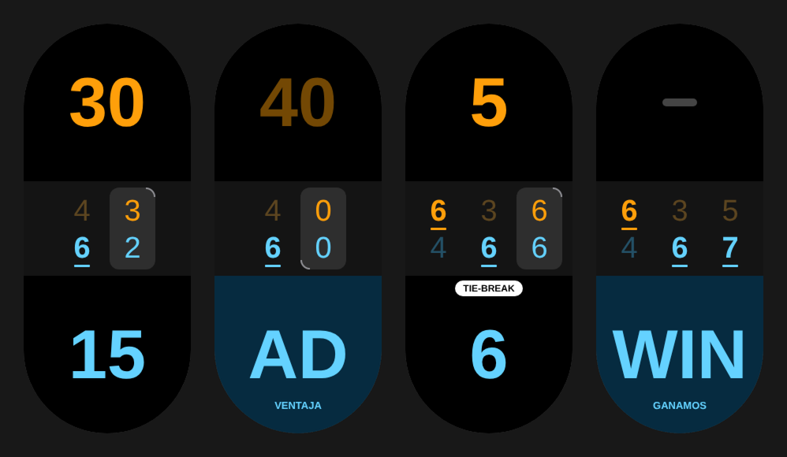
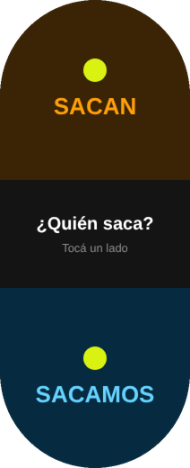
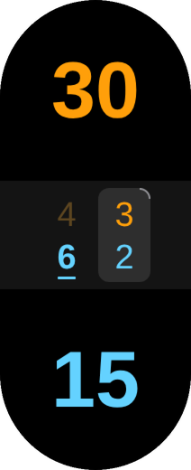
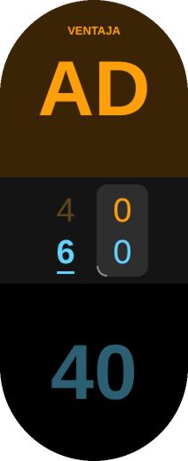
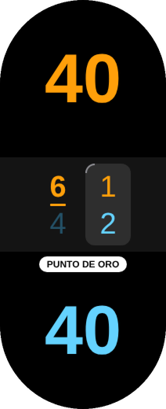
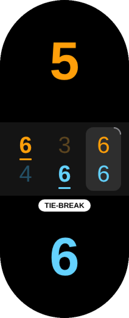
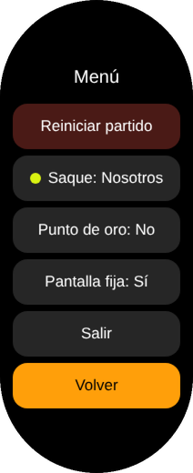

# Pádel — padel score counter for Xiaomi Smart Band 10

A padel scoreboard that runs on the **Xiaomi Smart Band 10**, built as a Xiaomi
Vela JS quick app (`.rpk`). Tap to score, swipe to fix mistakes, and see every set at
a glance without leaving the court.



<sub>Rendered from the compiled app in the test harness (212 × 520 px capsule
screen). The app's on-screen labels are in Spanish.</sub>

> **Unofficial.** Xiaomi has no public way to install third-party apps, so
> Pádel is installed by sideloading (see [Install](#install-with-miband-hack)).
> This project isn't affiliated with Xiaomi.

## Features

- **Split screen.** The top half (orange) is the opponents and the bottom half
  (blue) is your team, on a black panel. Orange/blue stays distinguishable
  with red-green color blindness, and black keeps the AMOLED panel cheap on
  battery.
- **Scoreboard in the middle.** It has one column per set, with the opponents'
  games on top and yours below. The set in play sits on a grey tile. In a
  finished set, the winner's number is bold and underlined and the loser's is
  dimmed.
- **Clear status cues.**
  - *Advantage:* the leading half lights up and shows a bold **AD** with
    *VENTAJA*, while the rival's 40 dims.
  - *Tiebreak / golden point:* a white pill (`TIE-BREAK`, `PUNTO DE ORO`)
    appears just below the scoreboard without moving anything else.
  - *Match over:* the winner's half lights up with **WIN** in its color and *GANAMOS*
    or *GANAN*, and the other half shows a dimmed bar.
- **Serve indicator.** A grey arc on one corner of the current-set tile
  shows who serves next and from which side. The tile's corners are the
  court seen from your side: top corners are the opponents, bottom corners
  are your team. So the marked corner is where the server stands, and you
  can point at it: "you serve from there now". Their right is the screen's
  left, because they face you.
- **Who serves first.** Each new match asks *¿Quién saca?*: tap the team
  that serves first. Everything else follows from the rules: teams
  alternate games (across sets too), each game starts from the right, and
  the side switches every point. In a tiebreak the team whose turn it is
  serves one point, then two each.
- **Full padel rules.** Points go 0 / 15 / 30 / 40 with deuce and advantage, or
  an optional **golden point** (*punto de oro*). Sets go to 6, won by 2, with a
  **tiebreak** to 7 (won by 2) at 6-6. Matches are best of 3.
- **Haptics.** You get a short buzz for each point and a long buzz when a point
  wins a game, so you can feel the score without looking.
- **Keep screen on.** This is optional. The setting is released when you leave
  the app.
- **Nothing is lost.** The match is saved after every point, so it survives if
  the band closes the app.

## How to use it

| Gesture | On the top half (them) | On the bottom half (us) |
| --- | --- | --- |
| **Tap** or **swipe right** | +1 point to them | +1 point to us |
| **Swipe left** | −1 point to them | −1 point to us |
| **Long-press** (anywhere) | Opens the menu | Opens the menu |

**Swipe left** removes that side's most recent point. If that point was the
last one played, it's fully undone, even if it closed a game or a set.

**Menu:**

- *Reiniciar partido*: start a new match. It asks who serves first again.
- *Saque: Nosotros / Ellos*: change which team served first, if it was
  set wrong. The serve indicator updates for the whole match.
- *Punto de oro: Sí / No*: turn the golden point on or off.
- *Pantalla fija: Sí / No*: keep the screen on while the app is open.
- *Salir*: exit the app.
- *Volver*: go back to the score.

> A right swipe adds a point here, so it **doesn't close the app** as it does
> elsewhere on the band. Use **Salir** in the menu to exit.

## Screens

| Who serves? | Mid-match | Our advantage |
| :---: | :---: | :---: |
|  |  |  |
| **Their advantage** | **Golden point** | **Tiebreak** |
|  |  |  |
| **We won** | **They won** | **Menu** (long-press) |
|  |  |  |

How to read the scoreboard in the middle: each column is a set, with their
games (orange) on top and ours (blue) below. In *Mid-match*, we won the first
set 6-4 (bold and underlined) and trail 2-3 in the second (grey tile). The
grey arc on the tile's top-right corner says they serve next, from their
left.

## Download

Get the latest `.rpk` from
[Releases](https://github.com/IlanVivanco/padel-band/releases). See the
[changelog](CHANGELOG.md) for what changed in each version. Release builds
are debug-signed and compiled to JSC bytecode, which is what the band needs to
sideload them.

## Install with MiBand Hack

[MiBand Hack](https://miband.trinh.uk)
([source](https://github.com/ptrinh/miband-hack)) is a web app that installs
`.rpk` apps on Mi Band 8 / 9 / 10 straight from the browser over Bluetooth.
You don't need to install anything.

### What you need

- **Chrome or Edge.** Safari and Firefox don't support Web Serial or Web
  Bluetooth. It has been tested from Chrome on Android. On Windows and Linux,
  desktop Chrome or Edge works too. On Linux you may need to turn on
  `chrome://flags/#enable-experimental-web-platform-features`. For macOS, see
  [Troubleshooting](#troubleshooting).
- **The band already paired with Mi Fitness.** That pairing is what produces
  the auth key.
- **The `.rpk`** from [Releases](https://github.com/IlanVivanco/padel-band/releases).

### 1. Get the auth key

Open [miband.trinh.uk](https://miband.trinh.uk). In **step 1**, sign in with
your Xiaomi account to fetch your band's auth key. The site uses the login once
and doesn't store it. The site lists other ways to get the key under *Other
ways to get the auth key*.

> The key changes if you **unpair the band in Mi Fitness or reset it**. If
> that happens, fetch it again.

### 2. Free the band

The band talks to only one device at a time.

- **Force-stop Mi Fitness**: Settings → Apps → Mi Fitness → Force stop. If you
  skip this, Mi Fitness reconnects and takes the connection.
- If you're installing from a **computer**, also turn off Bluetooth on your
  phone in its Settings, not just in quick settings.

### 3. Pair the band with this device (first time only)

1. If the band is already listed in this device's Bluetooth settings, remove
   it.
2. On the band, open **Settings → System → Connect to new phone** and keep
   that screen open.
3. Pair the band from this device's Bluetooth settings.
4. When pairing is done, return the band to its watch face.

### 4. Connect

In **step 2 (Connect)**, choose **Bluetooth Classic (SPP)**. The Smart Band 10
uses Bluetooth Classic, so it appears as a serial port. It doesn't show up in
the Bluetooth Low Energy scan.

1. Pick the band's port. On Windows, if there are two COM ports, it's usually
   the *outgoing* one.
2. If the band shows a pairing prompt, accept it on the band.
3. The first attempt often times out. Press **Connect** again.
4. A green **Connected** dot appears with the model and battery level.

### 5. Install

In **step 4 (Or install your own file)**, drop the `.rpk` file into the box and
press **Install to band**. When it finishes, open the app list on the band and
look for **Pádel**.

To update, install the newer `.rpk` the same way. It replaces the old version
and keeps the saved match.

### Troubleshooting

| What you see | What to do |
| --- | --- |
| The band doesn't appear when searching | Use **Bluetooth Classic (SPP)**, not BLE, and pair the band in the OS first (step 3). |
| `This .rpk contains plain JavaScript; the Mi Band 10 crashes on it` | The file wasn't compiled to bytecode. Use a release build, or build with `npm run build` (it passes `--enable-jsc`). |
| `Failed to open serial port` | Something else holds the port. Close other MiBand Hack tabs, force-stop Mi Fitness, toggle Bluetooth off and on, then reconnect. |
| `No reply from band` | The band is still on *Connect to new phone*, or Mi Fitness is connected. Return to the watch face, free the band (step 2) and reconnect. |
| `Authentication timed out` | The phone is still holding the connection. Turn its Bluetooth fully off and retry. |
| `NO_BOUND`, or the link drops before authentication | Repeat step 3. If the band was re-paired with Mi Fitness, get a new key. |
| macOS: the port won't open | Chrome on macOS can't open the band's Bluetooth Classic port. Use MiBand Hack's *Mac helper* (run it locally; see its [guide](https://github.com/ptrinh/miband-hack/blob/main/docs/GUIDE.md)), or install from an Android phone. |

### Other ways to install

- **Notify for Xiaomi** (Android, paid): open the `.rpk` with Notify, check that it says *Valid app
  file*, and tap **Install**.
- **[AstroBox](https://astrobox.online)**: install the `.rpk` over Bluetooth.
  It needs your Xiaomi account and the band's auth key.

## Build from source

You need Node.js (tested with v22).

```sh
npm install
npm test          # scoring logic unit tests (plain Node)
npm run test:ui   # layout + gesture tests on the compiled page (needs Playwright + Chromium)
npm run emulator  # dev emulator at http://localhost:5173/tools/emulator/
npm run build     # -> dist/com.ilanvivanco.padelband.debug.<version>.rpk
```

`npm run emulator` serves an interactive emulator of the band screen in your
browser. It runs on the app's own scoring and serve logic
(`src/common/padel.js`) and supports taps, swipes, long-press, the menu and
the who-serves screen. A side panel shows who serves and from where, jumps to
states (deuce, tiebreak, three sets…) and lets you try the serve cue's place,
stroke, length and color. It's a quick way to test rules and design ideas;
the UI tests remain the reference for exact layout.

`npm run test:ui` builds the plain-JS bundle and drives it in headless
Chromium through `test/harness/` (adapted from Calc+). It checks that every
state fits inside the capsule, that the points, scoreboard and pill are
centered, and that taps and swipes score on the right side. It also saves
screenshots to `test/screens/`. Run `npm run build` afterwards, because the
`.rpk` must be the JSC build.

To refresh the README images from those screenshots, run
`python3 tools/docs_images.py` (needs Pillow). It writes `docs/preview.png` and
`docs/screens/*.png`.

`npm run build` runs `aiot build --enable-jsc`. **Sideload only the debug
build**, and keep JSC on: the Band 10 won't run plain-JS packages.

To ship an update, bump `versionCode` and `versionName` in
`src/manifest.json`. Keep the package name (`com.ilanvivanco.padelband`)
unchanged. If it changes, the update won't install over the old version and the
saved match is lost.

### Project structure

```
src/
  manifest.json          app id, version, features (storage, vibrator, brightness, app)
  app.ux                 app entry
  pages/index/index.ux   screen layout, gestures, menu
  common/padel.js        pure scoring and serve logic (no system modules)
  common/serve-*.png     serve-cue arcs, one per tile corner (12 × 12)
  common/logo.png        app icon (120 × 120)
test/padel.test.mjs      scoring tests (node --test)
test/ui.test.mjs         layout and gesture tests on the compiled page
test/harness/            minimal Vela runtime for Chromium (from Calc+)
tools/emulator/          dev emulator (npm run emulator)
tools/serve.mjs          static server for the emulator
tools/docs_images.py     builds the README images from the test screenshots
docs/                    README images and app icon
CHANGELOG.md             version history
```

The match is stored as the sequence of point winners (`"uutu…"`) plus the team
that served first, and the score and serve are always derived by replaying
that sequence. Undo and subtract are just edits to the sequence, so neither
the score nor the serve can drift out of sync.

Vela supports neither per-side borders nor per-corner radii, so the serve arc
is a small image placed over the current-set tile's known position.

## Roadmap ideas

- Which player of the team serves (partners alternate)
- Configurable match format (single set, super tiebreak instead of a third set)
- Match summary and history

## Credits

The project layout and the test harness are based on
[Calc+](https://github.com/arimwilson/calcplus) by Ari Wilson (MIT). [MiBand Hack](https://github.com/ptrinh/miband-hack) by
ptrinh handles the sideloading.

## License

[MIT](LICENSE) © Ilán Vivanco
